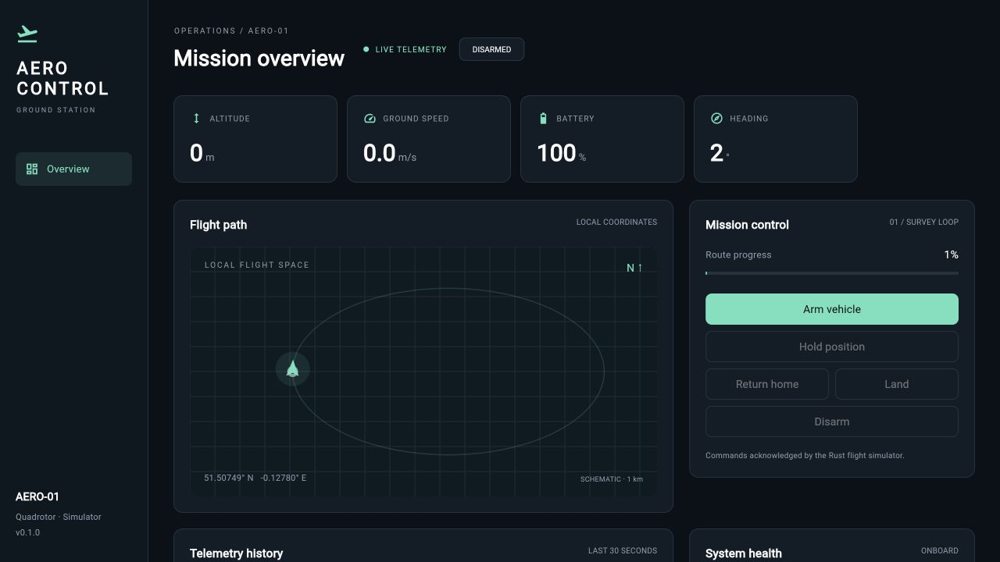
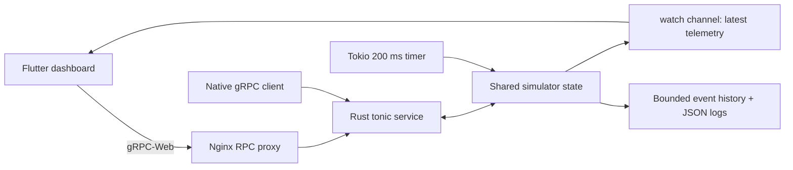

**Tech stack:** Rust, Tokio, Flutter, Dart, gRPC, Protocol Buffers, Nginx, Docker Compose, GitHub Actions

# AeroControl

A ground control station **simulator** built with Rust, Tokio, Flutter, Dart, gRPC and Protocol Buffers. One shared virtual quadrotor broadcasts telemetry at 5 Hz; every connected operator sees the same vehicle state.



## Run with Docker

Requires Docker Desktop / Docker Engine with Compose.

```sh
docker compose up --build
```

Open **http://localhost:8088**. Set `AEROCONTROL_WEB_PORT` or `AEROCONTROL_GRPC_PORT` to override the published ports. The dashboard reaches the Rust backend through a same-origin Nginx gRPC-Web proxy. Native gRPC is available at `localhost:50051`. Stop with `docker compose down`.

## Run locally

Requires Rust 1.85.1+, Flutter 3.29.3 (Dart 3.7), and protoc only if regenerating the checked-in Dart bindings.

```sh
# Terminal 1, repository root
cargo run -p aerocontrol

# Terminal 2
cd frontend
flutter pub get
flutter run -d chrome --web-port 8088 --dart-define=API_URL=http://localhost:50051
```

To serve a compiled release build without a Flutter development server, keep the Rust backend running, run `flutter build web --release --pwa-strategy=none --dart-define=API_URL=/` in `frontend`, then `python3 scripts/serve.py` from the repository root. Open http://localhost:8088.

The native transport is selected automatically outside the browser. To add a local desktop runner, run `flutter create --platforms=macos .` (or your platform) inside `frontend`, then run with that device. Web is the configured and tested deployment target.

## Try a flight

1. Arm the vehicle and confirm, then start the mission.
2. Watch altitude rise to 80 m, follow the survey loop, and inspect speed and system health.
3. Hold, resume, return home, or land. Disarming is rejected while airborne.
4. Expand **Simulation tools** and inject a GPS fault. The vehicle enters hold and raises an alert. Clear faults, then resume.
5. Inject a battery fault during flight to trigger automatic landing.
6. Stop the backend to see the disconnected state. Restart it; the dashboard reconnects automatically. Reset on the ground to restore the battery and route.

The deterministic survey lasts approximately two minutes, followed by return and landing. The local path view is a schematic, not a geographic basemap. Charts retain 150 samples (about 30 seconds). Telemetry freezes visibly with a disconnected banner if transport is lost; it is never replaced with fabricated frontend data.

## Architecture



- `proto/aerocontrol.proto`: shared service and message definitions.
- `backend/src/lib.rs`: deterministic flight model, command guards, health detection, bounded event log, RPC implementation.
- `backend/src/main.rs`: gRPC / gRPC-Web listener, simulation task and shutdown.
- `frontend/lib/services`: platform-specific channels and reconnecting controller.
- `frontend/lib/widgets`: custom-painted telemetry charts and local flight path.
- `deploy/nginx.conf`: same-origin browser proxy and static hosting.

### API

| RPC | Behavior |
| --- | --- |
| `GetSnapshot` | Latest complete vehicle state |
| `WatchTelemetry` | Immediate snapshot, then latest-state updates at 5 Hz |
| `ExecuteCommand` | Acknowledged state change or rejection with reason |
| `GetEvents` | Events after an ID, up to the retained 500 entries |

Commands: arm, disarm, start/resume mission, hold, return home, land, inject GPS fault, inject battery fault, clear faults, reset. Unknown enum values return `INVALID_ARGUMENT`; unsafe state transitions return `accepted=false`.

Battery below 20% or an injected battery fault triggers landing when airborne. GPS loss during mission or return switches to simulated hold. Clearing faults restores sensor health, but a landing already underway continues. Events log only health transitions, not every sample. The simulator uses a Tokio watch channel so slow subscribers receive the latest state without growing an unbounded queue.

### Reconnection and state

The dashboard marks a link stale after five seconds without telemetry, disables controls, and reconnects at 1, 2, 4, 8, then 16 second intervals. Commands have a four-second deadline and are never retried automatically. Event polling has a three-second deadline. Simulator state and the 500-entry event ring live in memory and reset on backend restart; JSON event records also go to stdout. There is no database, authentication, multi-vehicle routing, or physical autopilot integration. Multiple operators share one simulator; authorization and TLS are needed before any public deployment.

### Configuration

| Setting | Default | Usage |
| --- | --- | --- |
| `AEROCONTROL_ADDR` | `127.0.0.1:50051` | Rust bind address; container uses `0.0.0.0:50051` |
| `RUST_LOG` | `info` | Backend log filter |
| `API_URL` | `http://localhost:50051` | Flutter compile-time `--dart-define`; Docker uses `/` |

## Validate

```sh
cargo fmt --all -- --check
cargo clippy --locked --all-targets -- -D warnings
cargo test --locked --all-targets
cd frontend
flutter pub get
flutter analyze
flutter test
flutter build web --release --pwa-strategy=none --dart-define=API_URL=/
```

Rust unit tests cover transition guards, fault response, bounded logging and a complete flight. Integration tests run a real gRPC server on an ephemeral port and exercise streaming, commands, event cursors and client reconnection. Flutter tests cover mobile/desktop layout, offline control gating, and reconnection to a real Dart gRPC test server.

To regenerate Dart messages after editing the protocol:

```sh
./scripts/generate-proto.sh
```

Rust messages are generated automatically by `build.rs`, using a vendored protoc binary. Commit both lockfiles and generated Dart sources. GitHub Actions runs format, lint, test, protocol consistency and release web build checks, uploads the web artifact, and smoke-tests the Docker stack. A `v*` Git tag runs the same validation before publishing versioned backend and dashboard images to GHCR. No cloud host is provisioned; deployment is `docker compose up --build -d` on your chosen host.

## Implementation references

- [tonic-web](https://docs.rs/tonic-web/0.12.3/tonic_web/) for Rust browser transport.
- [Dart gRPC](https://pub.dev/packages/grpc) for native and web clients.
- [Flutter web deployment](https://docs.flutter.dev/deployment/web) for static builds.
